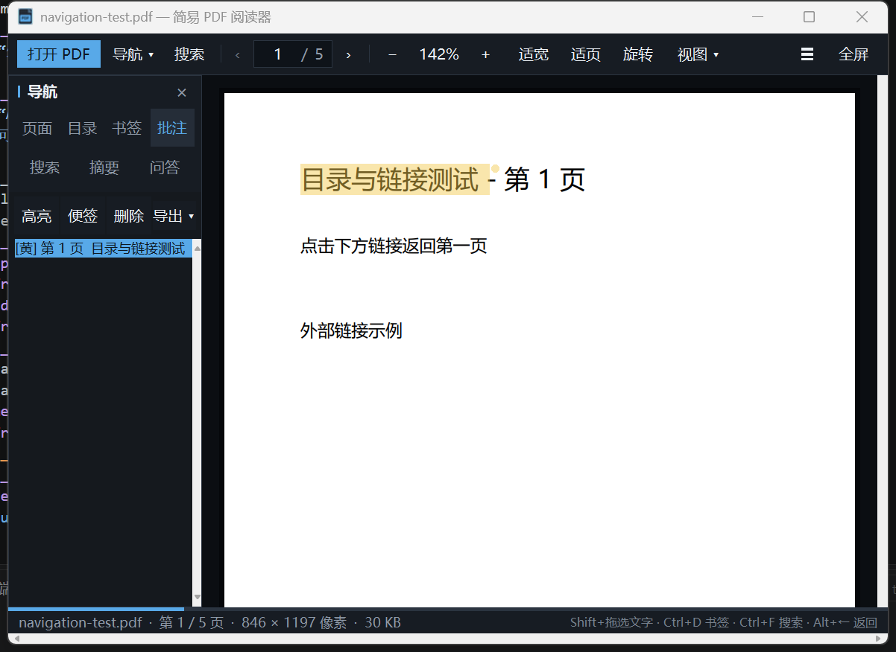

# Simple PDF Reader

[简体中文说明](README.zh-CN.md)

A lightweight, offline-first PDF reader for Windows, built with Python,
Tkinter, and PDFium. The interface is in Chinese, while the project code and
documentation are suitable for an international open-source repository.



## Features

- Password-protected PDF support
- Single-page, two-page spread, and continuous reading modes
- Page thumbnails, PDF outlines, search results, and reading progress
- Full-text search with cross-page highlighting
- Text selection, clipboard copy, colored highlights, and page notes
- Native PDF highlight and sticky-note export, with user bookmarks as outlines
- Encrypted source documents remain encrypted in the exported copy
- User bookmarks, navigation history, and automatic reading-position restore
- Dark reading mode, zoom, rotation, fit-to-width, and drag-to-pan
- Local extractive summaries with keywords and key sentences
- Optional OpenAI-compatible API integration for AI summaries and document Q&A
- Page citations such as `[p.12]` in AI answers
- Drag and drop a PDF directly into the application

## Platform and dependencies

- Windows 10 or Windows 11
- Python 3.12 for source builds
- No Python installation is needed when using the released executable

The application depends on Windows DPAPI for encrypted API-key storage. A
cross-platform build would need a different secret-storage implementation.

## Download and run

Use the executable from the latest GitHub Release, or build it locally.

### Run from source

```powershell
python -m venv .venv
.\.venv\Scripts\Activate.ps1
python -m pip install -r requirements.txt
python app.py
```

### Build the executable

```powershell
powershell -ExecutionPolicy Bypass -File .\build.ps1
```

The output is written to `dist\PDFReader.exe`.

## Annotation export

Use **批注 → 导出 ▾ → 带批注 PDF…** to write a new PDF containing the current
highlights, sticky-note annotations, and user bookmarks. The original document
is not overwritten. Password-protected source files remain encrypted in the
exported copy and use the password entered when the original was opened.

This release exports annotations rather than editing page text, images, page
order, forms, or signatures in place.

## API configuration

Open **导航 → API 设置** and provide:

- A compatible Chat Completions `Base URL`, usually ending in `/v1`
- A model name supported by that provider
- An API key when required by the provider
- Optional output-token and context-length limits

The default endpoint is OpenAI's API URL, but no provider or model is bundled.
Compatible local services such as LM Studio or Ollama can be used without a
remote API key. The application does not verify provider pricing, availability,
or model behavior.

API keys are encrypted with Windows DPAPI and saved outside the repository in
the current user's application-data directory.

## Privacy

Normal reading, search, annotations, bookmarks, and local summaries stay on the
device. No telemetry is collected.

When AI summary or document Q&A is used, relevant extracted text excerpts are
sent to the API endpoint configured by the user. The application does not send
the complete PDF unless the selected excerpts happen to cover it. See
[PRIVACY.md](PRIVACY.md) for details.

## Keyboard shortcuts

| Action | Shortcut |
|---|---|
| Open a file | `Ctrl+O` |
| Search | `Ctrl+F` |
| Next / previous search result | `Enter` / `Shift+Enter` |
| Previous / next page | `Page Up` / `Page Down` or arrow keys |
| First / last page | `Home` / `End` |
| Zoom | `Ctrl+mouse wheel`, `Ctrl++`, or `Ctrl+-` |
| Fit width | `Ctrl+0` |
| Full screen | `F11` |
| Cycle reading modes | `Ctrl+M` |
| Toggle sidebar | Toolbar `☰` button |
| Select text | Hold `Shift` and drag |
| Copy selected text | `Ctrl+C` or the context menu |
| Add / remove page bookmark | `Ctrl+D` |
| Back / forward | `Alt+←` / `Alt+→` |

## Current limitations

- Windows only
- No OCR; scanned PDFs need a text layer before search and summary can work
- Text selection uses a single-page rectangular region
- Annotations are stored as sidecar data and exported to a separate PDF
- The application is currently organized as a single Python module

## Contributing

Bug reports and focused pull requests are welcome. See
[CONTRIBUTING.md](CONTRIBUTING.md) and [SECURITY.md](SECURITY.md) before
submitting changes or reporting a vulnerability.

## License

Application code is released under the [MIT License](LICENSE). Third-party
component notices are listed in
[THIRD_PARTY_NOTICES.md](THIRD_PARTY_NOTICES.md) and
`third_party_licenses/`.
